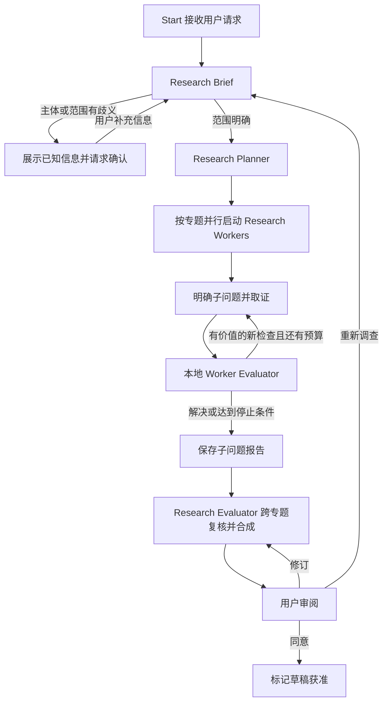

# 尽职调查代理架构

项目用于从公开来源对企业或相关主体做初步调查和风险筛查，当前通过 CLI 生成带引用的审阅稿。

## 调查图

- **Research Brief** 建立调查对象的身份图谱，包括主体标识、别名、品牌、代码、控制结构及沿革。记录重点特征、用户目的与关注点、范围、候选专题和来源。歧义影响调查时，当前轮结束并等待回答。用户也可以只要求完成 Brief。
- **Research Planner** 按 Brief 拆分和排序任务。每个任务包括具体问题、研究价值、完成标准、检索标识和已知原文地址。程序按问题去重后再应用专题数量上限。
- **Research Worker** 为每个专题开启独立 ADK 动态子分支。研究代理获取来源并提出阶段性答案，本地评估代理判断覆盖程度、价值和证据可靠性，并写出子报告。只有评估提出了新而具体的高价值检查且预算未用尽，当前 Worker 才继续。子报告保留 `complete`、`partial` 或 `unresolved` 状态、研究次数和适用的停止原因。
- **Research Evaluator** 读入全部子报告，核查关键依据及冲突，按用户目的组织叙事并删除无关细节。输出后可用自然语言或 `/revise` 请求部分修改，用 `/restart` 回到 Brief，或用 `/approve` 标记草稿获准。命令由程序直接路由，自然语言草稿反馈由轻量分类代理判断。

## 模块与数据边界

| 模块 | 职责 |
| --- | --- |
| [workflow.py](../due_diligence/workflow.py) | 声明图边、确认分支、Worker 循环和结构化交接模型。 |
| [agents.py](../due_diligence/agents.py) 与 [prompts/](../due_diligence/prompts/) | 创建职责独立的代理，共用来源工具，各自的指令按角色放在 Markdown 文件中。 |
| [runtime.py](../due_diligence/runtime.py) | `ResearchAssistant.ask()` 运行一轮，返回 `Turn`，其中包含答复、阶段、调用轨迹和 `ResearchRecord` 快照。 |
| [sources.py](../due_diligence/sources.py)、[http_sources.py](../due_diligence/http_sources.py) | 隔离原生 Google 工具，提供 HTTPX 原文取回和定位。 |

`ResearchRecord` 保存 Brief、Plan、Worker Reports、草稿和审阅状态，可用 `/brief` 查看已记录的 Brief。同一实例的用户请求串行，每轮新建并在结束后释放 ADK 内存 Session。跨轮由 `ResearchAssistant` 持有案件快照和有限对话历史，进程退出或 `/reset` 后清空。持久证据库、Word 导出和 Web UI 可以围绕这些交接点接入。

## 网络工具与技能

Brief、Planner、Worker、本地评估和最终 Evaluator 都拥有完整的公开来源工具，按当前阶段的任务使用。

- `search_public_web` 用于发现，Google Search grounding 结果单独显示给当前用户。调查代理接收调用状态，原文工具使用独立确定或由用户提供的地址。
- `read_public_url` 使用 URL Context 解读指定页面。只有 Gemini 对指定地址返回成功状态时，才交回提取内容。
- `fetch_public_document` 通过 HTTPX 读取原始 HTML、文本、JSON、XML 和含文字层的 PDF。可读取原始文本或整理后的 HTML，支持文字偏移和 PDF 页号。每次重定向重新检查目标，连接固定到已校验的公网地址。请求超时、响应体、返回文本长度和跳转次数由配置限制。

[config.toml](../config.toml) 默认每批 8 个专题、每个 Worker 最多 2 次补查、每轮 24 次来源调用，其中 4 次留给最终复核阶段。共享预算耗尽时，保留各 Worker 已查明的结果和未解决事项。

[skills/](../skills/) 保存原样下载的上游技能、随附资源及许可证。运行时通过 `google.adk.skills.load_skills_from_dir()` 读取原生 `SKILL.md`，并由 ADK 的 `SkillToolset` 提供 `list_skills`、`load_skill` 和 `load_skill_resource`。上游技能用于辅助本项目的调查节点，工具集提供说明和资源读取。导入版本与兼容性选择记录在 [技能来源清单](../skills/UPSTREAM.md)。 [ADK 技能文档](https://adk.dev/skills/)

## 验证

运行 `uv run --locked python -m unittest discover -s tests -v`。离线用例以脚本化模型执行真实 ADK 图，覆盖歧义、并行任务、局部研究回路、复核预算和反馈。HTTPX 使用模拟传输验证跳转、公开地址校验和 PDF 页码。CLI 的 `--trace` 可以显示实际经过的节点和工具。
