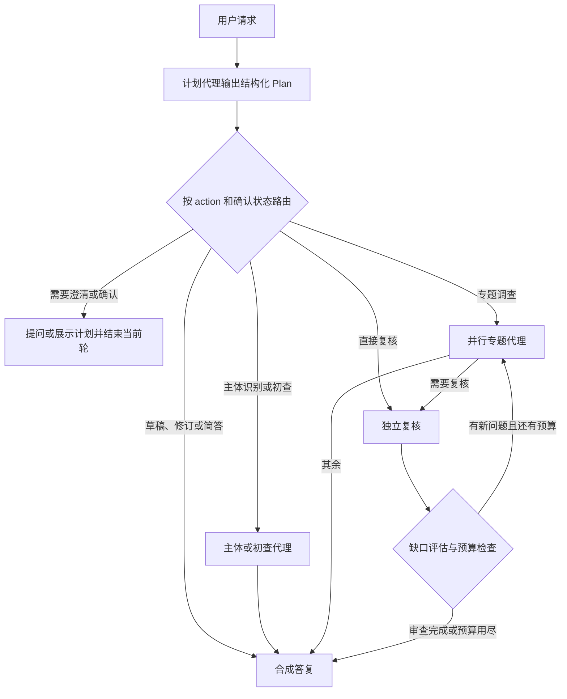

# 尽职调查代理架构

## 项目范围

项目面向企业公开来源的初步尽职调查。用户可以先识别主体和控制关系，再看概况、选专题、复核重点结论和修订草稿，也可以指定当前就要完成的工作。现有交付入口是 CLI，报告草稿以对话文本呈现。持久化证据库、学习门控、Word 导出和 Web UI 属于后续开发阶段。

## 模块与调用关系

| 模块 | 职责 |
| --- | --- |
| [cli.py](../due_diligence/cli.py) | 解析参数，管理交互式案件，输出答复和调试轨迹。 |
| [runtime.py](../due_diligence/runtime.py) | `ResearchAssistant` 负责一次案件会话。每轮启动 ADK Runner，管理上下文、工具预算和临时搜索结果。 |
| [workflow.py](../due_diligence/workflow.py) | 定义 Google ADK Graph Workflow、条件路由、专题并行和复核后的补查回路。 |
| [agents.py](../due_diligence/agents.py) 与 [prompts/](../due_diligence/prompts/) | 构建计划、主体识别、初查、专题、复核、缺口评估和撰写代理。各职责的提示词分文件维护，公开来源规则供检索与撰写代理共用。 |
| [sources.py](../due_diligence/sources.py) 与 [preview.py](../due_diligence/preview.py) | 封装 ADK 内置 Google Search 和 URL Context，保留网页读取状态，并提供临时本机搜索预览。 |
| [config.py](../due_diligence/config.py) 与 [config.toml](../config.toml) | 校验运行配置并创建 Gemini 客户端。客户端只从项目根目录的 `.env.local` 读取凭据。 |

程序入口是异步方法 `ResearchAssistant.ask(message)`。返回的 `Turn` 包含答复、经过的阶段、工具轨迹、来源调用数和本轮临时搜索结果。一个实例对应一个案件会话，完成后调用 `close()`。同一实例的用户请求串行执行，单轮内部可以并行调查多个专题。

## 调查图

计划代理读取当前请求、近期对话和待确认计划，通过结构化 `Plan` 给出目标、专题列表和是否需要确认等字段。实际边由 Python 根据 `Plan` 选择。范围已明确的请求可直接进入相关节点，例如第一轮就复核某项结论，或在新证据出现后重做初查。

需要确认时，图展示并保存待确认计划，然后结束当前轮。下一轮识别到用户批准该计划时，从已保存版本取专题，避免把新一轮模型临时生成的其他专题带入执行。专题节点通过 ADK 动态子节点并行运行，按专题配对汇总结果。需要复核时，复核代理主动寻找相左或更新的公开材料。缺口代理输出结构化补查问题，图去除已查过的问题，并在仍有补查轮次和来源预算时返回专题节点。

每轮新建一个内存 ADK Session，结束后删除。跨轮只在 `ResearchAssistant` 中保留近期用户消息、截断后的答复和待确认计划。专题发现和复核记录在当前轮汇总，未来的证据引擎可补充跨轮、跨案件的证据检索。CLI 的 `/reset` 会新建案件实例。

## 来源处理与预算

- **Google Search 用于发现线索。** `search_public_web` 调用只配有内置 `google_search` 的独立代理。搜索正文和 grounding 元数据通过 `Turn.searches` 交给当前用户的临时预览。主调查图收到的是检索状态，搜索正文留在当前轮的预览路径。
- **URL Context 用于读取指定原文。** `read_public_url` 检查公开 HTTP(S) 地址，再调用单独配置了 `url_context` 的代理。`UrlReadingGemini` 保留 SDK 返回的抓取元数据。只有请求地址对应的状态为成功时才返回提取内容。若跳转后只返回最终地址，可以用最终地址重试。
- **工具预算与专题预算分别计算。** 当前默认每轮最多发起 24 次来源调用，搜索和 URL 读取共用此限额。一次有合法参数并已发出的调用会占用预算，即使上游失败。每批最多 8 个专题，最多补查 2 轮。主图的 ADK Runner 每轮模型调用上限为 64，单独运行的来源代理各自只允许一次模型调用。模型默认 `gemini-4-neon`，思考强度为 `MEDIUM`。

公开网页内容仅作研究材料。提示词要求区分已证实事实、指控、推断与查证缺口，并保留关键主张的来源、日期和位置。高影响结论通过复核分支检查来源独立性、时效和相反证据。抓取成功仅说明服务读取了指定页面，材料是否支持结论仍由调查和复核判断。

## 维护与扩展

1. **调整调查方法。** 修改 [prompts/](../due_diligence/prompts/) 下对应代理的指令。新增路线时同时检查 `Plan.action`、图的路由映射和对应测试。
2. **接入证据引擎。** 通过来源读取和调查结果的交接点收集候选证据，通过复核节点更新审查状态。保存原文定位和结论引用关系，后续轮次按案件与专题检索。
3. **接入报告与界面。** 先复用 `ResearchAssistant.ask()` 和 `Turn` 做交互。Word 导出可从合成阶段取得经用户审阅的草稿及引用，再交给独立的文档模块。
4. **验证改动。** 用 `uv run --locked python -m unittest discover -s tests -v` 跑离线回归。需要观察真实路径时，使用 CLI 的 `--trace`。并行节点的工具轨迹可能交错。

设计参考了深度研究代理的协作规划与迭代阅读。项目用本地 ADK 图执行这些步骤。 [Gemini Deep Research](https://aistudio.google.com/docs/deep-research#collaborative-planning) · [ADK Graph Routes](https://adk.dev/graphs/routes/) · [ADK Dynamic Workflows](https://adk.dev/graphs/dynamic/)
